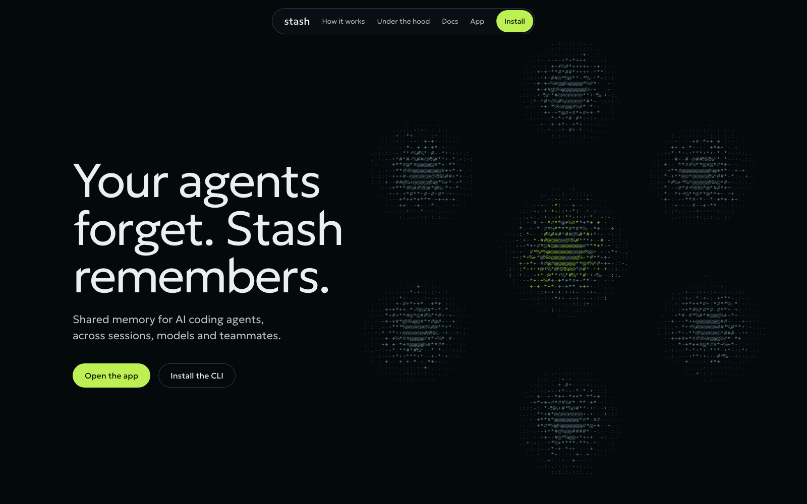

# Stash

**Your agents forget. Stash remembers.** Agent memory across sessions, laptops, models and teammates.



When an AI coding agent's session ends, everything it learned is lost: what it tried, what worked, what failed. The next agent starts from zero. Stash saves that knowledge with its evidence, so any agent, on any laptop or model, continues where the last one stopped. Repeated mistakes become rules a person approves, so a team's agents get smarter with every session.

Built in a day for **Agents in Context Toronto**, a MongoDB hackathon, on MongoDB Atlas and Atlas Vector Search.

## How it works

```text
 Your agent ── stash push ──►  MongoDB Atlas  ── stash pull ──►  Any agent
 a coding session              memories + vectors                any laptop, any model
```

| Step | What happens |
| --- | --- |
| **Push** | The CLI reads the agent's session log on your laptop, removes secrets before anything leaves it, and uploads only what's new. Your own AI tool (Claude Code, Codex, or any command) turns the session into **Memories**, each linked to the evidence that proves it. Stash holds no AI key. |
| **Pull** | `stash pull <id>` prints a **Briefing**: the rules to follow, what was decided, discovered and ruled out, and related findings from other sessions. It's built straight from the database with no AI call, in about a second. |
| **Merge** | `stash merge <a> <b>` reconciles two investigations into duplicate, complementary and conflicting **Findings**. Conflicts are kept, never voted away, and the sources are never changed. |
| **Learn** | When the same failure shows up in two sessions, Stash proposes a **Guardrail**. Only a person with the approver secret can approve it; then every Briefing starts with it. |

### MongoDB

- **Atlas** stores every session, event, memory, merge and guardrail as documents, so each memory traces back to the exact command output or file change behind it.
- **Automated Embedding** (`voyage-4`) turns every memory into a vector as it's saved, with no embedding service or key.
- **One Vector Search index** powers recall: related memories in every Briefing, merge candidates, spotting repeated failures, and search by meaning in the app.

## Quick start

You need Node 26, git, Claude Code and a MongoDB Atlas cluster with Vector Search. Stash isn't on npm yet, so it's installed from this repository.

```bash
git clone https://github.com/haris-sujethan/stash.git && cd stash
npm install && npm run build
(cd apps/cli && npm link)          # puts `stash` on your PATH
cp .env.example apps/web/.env.local
```

Set `MONGODB_URI` in `apps/web/.env.local` to your Atlas connection string, then:

```bash
npm run dev                         # the API, website and docs on http://localhost:3000
```

In a second terminal:

```bash
npm run seed                        # creates the indexes, asks for an approver secret, prints a token
stash login                         # paste the token
cd ~/your-repo && stash init        # joins this repo's Project; commit the .stash.json it writes
```

In Claude Code, run `! stash push` at the end of a session, or `stash hooks install` once to push automatically. On any machine, `stash pull <session id>` continues from it.

## Commands

| Command | What it does |
| --- | --- |
| `stash login` | Save your Stash token |
| `stash init` | Join (or create) the Project for this repository |
| `stash push` | Save this agent session: capture, redact, upload, extract Memories |
| `stash pull <id>` | Print a Briefing for a Session or Merge |
| `stash merge <a> <b>` | Reconcile two Sessions |
| `stash sessions` · `stash status` | List Sessions · check the setup |
| `stash guardrails` | List Guardrails (read-only; approve on the website) |
| `stash hooks install` | Push automatically from Claude Code |

## Key words

| Word | Meaning |
| --- | --- |
| **Project** | One repository. Every clone shares one Project. |
| **Session** · **Version** | One agent conversation · a snapshot of it each time it's pushed |
| **Event** · **Transcript** | One thing that happened (a message, command, output, edit or error) · all of them in order, secrets removed |
| **Memory** | One thing the agent learned, citing its Events. A **Decision**, **Discovery**, **Failed approach**, **Constraint** or **Open question**; **Hypothesis**, **Evidenced**, or **Verified** by a person |
| **Digest** · **Briefing** | A session's summary · what `stash pull` gives the next agent |
| **Merge** · **Finding** | Two sessions reconciled · one comparison inside it |
| **Guardrail** | A rule learned from repeated mistakes, reaching agents only once a person approves it |
| **Lineage** | Which session continued which |

## Security

- **Secrets are removed on your laptop** before anything is uploaded or sent to an AI tool: API keys and tokens (Anthropic, OpenAI, AWS, GitHub, Slack, Google, Stripe, Stash, JWTs, `Bearer`), private keys, database credentials, and every value in the repository's `.env` files. If scanning fails, nothing is uploaded.
- **The web app only listens on `127.0.0.1`.** It has no login of its own; run it on the machine you use it from.
- **Only people approve.** Approving a Guardrail or verifying a Memory needs the approver secret, checked by the server on every request and stored only as a scrypt hash. The CLI has no approve command.
- **No AI key.** Reasoning runs through the user's own AI tool, which is called with its tools and hooks disabled.
- Stash tokens are stored as SHA-256 hashes; the CLI's config file is readable only by its owner.

## Project layout

```text
apps/cli                 the `stash` command
apps/web                 Next.js: the API, the website, the docs, and the seed and reset scripts
packages/context-format  the data model and API types (zod)
packages/core            Briefings, extraction, merge and guardrail logic, ids, validation
packages/agent-adapters  reads Claude Code sessions
packages/llm-adapters    runs Claude Code, Codex or any command for reasoning
docs                     developer guide, glossary, decisions (adr/), build plan, demo guide
design/landing           the landing page design and its explorations
```

## Development

```bash
npm run build    # all workspaces
npm test         # 70+ tests, no network or AI calls
npm run dev      # web app with hot reload
```
